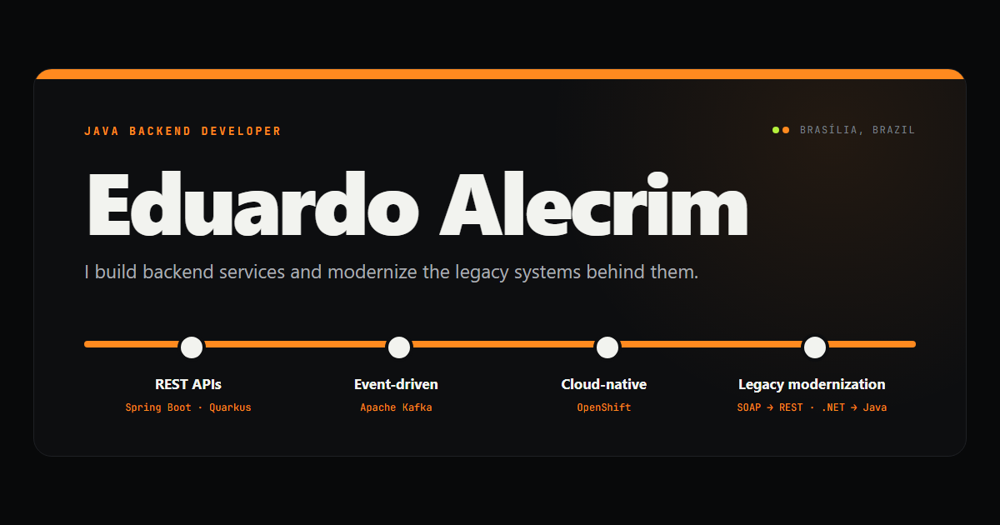

# eduardo-alecrim.github.io

[](https://eduardo-alecrim.github.io)
[](https://github.com/eduardo-alecrim/eduardo-alecrim.github.io/actions/workflows/ci.yml)

Personal portfolio of **Eduardo Alecrim**, Java backend developer in Brasília, Brazil.

[](https://eduardo-alecrim.github.io)

The design borrows from Brasília's metro signage, which runs two lines, green and orange: a station name board on top, line diagrams for experience and education, and five legacy modernization case studies.

## Features

- **Static and dependency-free.** Plain HTML, CSS and JavaScript, served as-is by GitHub Pages; there is no build step.
- **English and Portuguese.** The page opens in English and switches to Portuguese with the EN/PT toggle, which remembers the visitor's choice.
- **Motion with a fallback.** Trains run along the lines, stations light up and sections reveal on scroll. With *reduce motion* turned on, the page shows its final state, still.
- **Scales with the screen.** Every size is in `rem`, and the root size grows on large monitors, so the layout keeps its proportions from phones to ultrawide screens.
- **Accessible and shareable.** Semantic landmarks, a skip link, visible focus, a custom 404 page, Open Graph preview, `robots.txt` and `sitemap.xml`.

## Structure

```text
.
├── index.html              # the page, with the English copy
├── 404.html                # "station not found"
├── assets/
│   ├── css/main.css        # tokens, layout, components and motion
│   ├── js/i18n.js          # the Portuguese copy
│   ├── js/main.js          # language toggle, typed tagline, scroll reveals
│   └── img/                # favicon and social preview image
├── robots.txt
├── sitemap.xml
└── .github/workflows/ci.yml  # validates the HTML on every push
```

## Editing

Every translatable element in `index.html` carries a `data-i18n` key. To change a text, edit the English in `index.html` and the Portuguese under the same key in `assets/js/i18n.js`.

## Running locally

Open `index.html` in a browser, or serve the folder to test the 404 page and absolute paths:

```sh
python -m http.server 8000
```

Then visit <http://localhost:8000>. To check the HTML the same way CI does:

```sh
npx html-validate@9.5.0 index.html 404.html
```

## Deployment

GitHub Pages publishes the `main` branch from the repository root. A push to `main` goes live within a minute or two.

## Credits

Technology logos come from [Simple Icons](https://simpleicons.org) (CC0-1.0); the brands belong to their owners.

© 2026 Eduardo Alecrim. All rights reserved.
